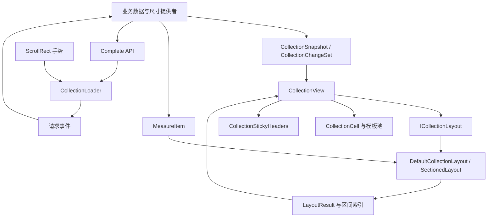
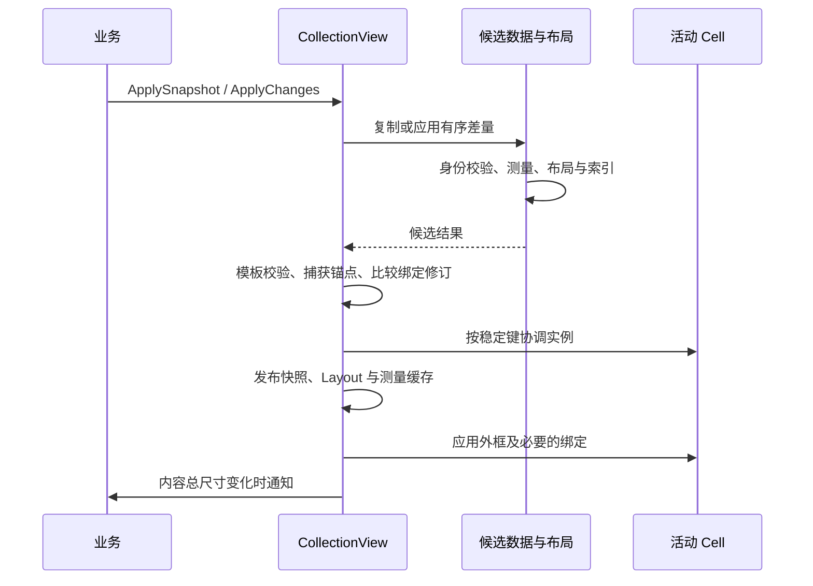
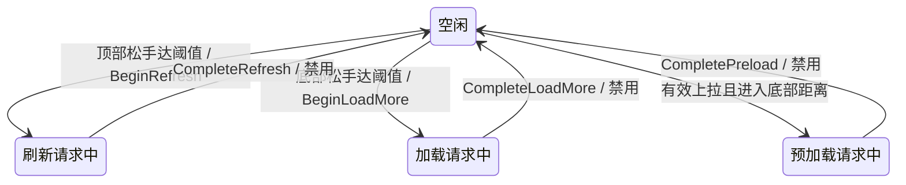

# CollectionUI 详细设计

本文描述当前组件的实际实现，面向维护者和需要扩展布局、测量、Cell 或加载交互的开发者。业务接入步骤见 [README](Assets/CollectionUI/README.md)。本文不把计划功能写成已实现能力。

## 1. 目标与职责边界

组件将数据、尺寸计算、几何布局和视图实例分离，使业务可以用同一套接口展示标签、卡片及任意矩形集合。Scroll 模式只创建视区附近的实例，Expanded 模式则把同一布局完整放入普通 UI 节点。

核心目标是稳定的身份、可预测的尺寸所有权、受控的绑定生命周期，以及数据更新时连续的滚动位置。组件参考原生集合视图的数据源、测量和复用思想，但实现基于 UGUI，并不是 UITableView/UICollectionView 的完整复刻。

| 责任 | 所有者 |
|---|---|
| 业务数据、稳定 ID、内容版本、分页游标 | 业务 |
| 按内容和可用宽度决定尺寸 | 业务 MeasureItem 或可选通用测量器 |
| 分区排列、元素矩形、内容总高度 | 布局引擎 |
| 可见性查询、实例复用、Cell 外框 | CollectionView |
| 字体、文字、图片、点击行为、内部元素布局 | Cell 子类 |
| 触发加载请求、互斥、指示器实例与位置 | CollectionLoader |
| 请求网络、异常提示、提交数据、确认结束 | 业务 |
| 页面安全区、集合所在父区域 | 宿主页面 |

运行时不包含商品、标签等业务模型，不访问 ParcelSorter 服务、网络或应用资源。安全区由宿主处理，演示中的 DemoSafeArea 只是接入示例。

## 2. 模块结构



| 文件 | 关键职责 |
|---|---|
| [CollectionModels.cs](Assets/CollectionUI/Runtime/CollectionModels.cs) | 数据模型、尺寸描述、不可变布局元素与身份键 |
| [CollectionChangeSet.cs](Assets/CollectionUI/Runtime/CollectionChangeSet.cs) | 有序差量操作、候选事务与身份验证 |
| [ICollectionLayout.cs](Assets/CollectionUI/Runtime/ICollectionLayout.cs) | 几何引擎接口及内置适配器 |
| [SectionedLayout.cs](Assets/CollectionUI/Runtime/SectionedLayout.cs) | 三种布局、分区复用、LayoutResult 与查询索引 |
| [CollectionView.cs](Assets/CollectionUI/Runtime/CollectionView.cs) | 初始化、缓存、提交、可见性、对象池及锚点 |
| [CollectionView.Navigation.cs](Assets/CollectionUI/Runtime/CollectionView.Navigation.cs) | 分组定位、拖动基准校正与回调重入保护 |
| [CollectionCell.cs](Assets/CollectionUI/Runtime/CollectionCell.cs) | 绑定世代、取消令牌、业务生命周期 |
| [CollectionStickyHeaders.cs](Assets/CollectionUI/Runtime/CollectionStickyHeaders.cs) | 分区索引、吸顶叠层、推挤和独立复用 |
| [CollectionLoader.cs](Assets/CollectionUI/Runtime/CollectionLoader.cs) | 请求状态、手势判定、loading 实例及位置控制 |
| [ContentLayouts.cs](Assets/CollectionUI/Runtime/ContentLayouts.cs) | 单行内容与纵向元素组合测量 |
| [UguiTextMeasurer.cs](Assets/CollectionUI/Runtime/UguiTextMeasurer.cs) | UGUI Text 测量、换行、省略及缓存 |

程序集分为 Runtime、Samples、Editor、Tests。Runtime 仅依赖 Unity 引擎和 Unity.ugui；业务可以只保留运行时。Editor 的演示工具引用 Samples，不能仅删除 Samples 而保留依赖它的工具代码。

## 3. 数据模型与身份

### 3.1 数据层级

```text
CollectionSnapshot
└─ Sections：有序 CollectionSection 列表
   ├─ Id：分区身份
   ├─ Layout：排列策略、列数、内边距及间距
   ├─ Header：可选 CollectionItem
   ├─ Items：有序普通条目
   └─ Footer：可选 CollectionItem

CollectionItem
├─ Id：数据身份
├─ ReuseIdentifier：模板/池身份
├─ Version：业务内容版本
├─ Size：固定、比例或测量描述
└─ Data：业务对象引用
```

索引是位置，ID 是身份。普通条目移动到其他分区后身份不变；同 ID 的内容更新仍是同一条目。分区 ID 全局唯一，普通条目 ID 也全局唯一。页眉/页脚按分区区分，允许不同组使用相同补充元素 ID。

`LayoutEntry` 记录 Item、SectionId、SectionIndex、ItemIndex、Kind、Rect。普通 ItemIndex 非负，Header 为 -1，Footer 为 -2；SectionIndex 保留原快照索引，包括被隐藏的空分区。

内部布局键区分普通条目与补充元素，并使用带长度的信息编码 ID，避免简单分隔符拼接碰撞。普通条目键只依赖条目 ID；页眉/页脚键还依赖种类和分区 ID。调用方使用业务 ID，不需要构造布局键。

### 3.2 复制、冻结与共享

公开快照可修改；发布到布局中的条目元数据被冻结，属性写入会抛出异常。`CollectionSnapshot.Copy()` 返回独立、可修改的元数据和容器，但 Data 仍共享原引用。

内部 `CopyForTransaction()` 复制分区、配置和列表，仅共享已经冻结的条目；可变条目仍复制。这样在分页时避免为每个未变化条目重复分配对象，同时维持候选与当前数据隔离。

`PrepareLayoutKey` 在身份未变时复用缓存键；冻结的页眉/页脚换分区或角色时先复制，再建立新键。调用处必须使用其返回值，不能修改旧布局持有的身份。

内置布局的 `BuildOwned` 只消费组件已拥有的私有候选。公开 `SectionedLayout.Build` 保留复制隔离。自定义布局始终收到 `data.Copy()`，即使它保存并修改输入，也不会污染已提交的列表和分区配置。该隔离不覆盖 Data 内部状态，自定义布局也应保持业务数据只读。

### 3.3 三种版本概念

| 概念 | 含义 | 典型变化时机 |
|---|---|---|
| CollectionItem.Version | 业务内容版本，参与测量/绑定比较 | 业务内容变化并影响测量 |
| CollectionCell.BindingVersion | 实例当前绑定世代 | 绑定、解绑 |
| 内部展示修订 | 某个布局键需要重新呈现的修订 | 显式更新、重绑、样式失效等 |

展示修订用于让普通 Cell 和吸顶副本识别同一数据变化，避免只比较布局对象引用而漏掉 `ReloadItems` 或同帧更新。不要用 BindingVersion 代替业务内容版本。

## 4. 几何与尺寸协议

### 4.1 坐标和所有权

布局坐标以内容左上角为原点，X 向右，Y 向下；Rect 中的坐标非负、宽高为正且有限。应用到顶部锚定的 RectTransform 时，Y 转为相反符号。所有值为 Canvas UI 单位。

Scroll 模式初始化时关闭横向滚动、开启纵向滚动，规范化 Content 的顶部锚点/轴心。集合负责 Content 高度和 Cell 外框，Viewport 尺寸由宿主负责。

Expanded 使用自身作为内容容器，不改变宿主宽度、锚点、轴心或位置；AutoHeight 决定是否写入高度。不能由集合和外部 LayoutGroup/ContentSizeFitter 同时控制同一个尺寸或位置。Cell 内部布局可以由业务自由选择。

### 4.2 尺寸解析

1. 根据分区内边距取得可用宽度。
2. Columns 再扣除列间距、除以列数，得到单列宽度；Flow/Skyline 使用分区内部宽度。
3. 条目 Size.Width 为 0 时采用上述宽度，否则采用显式宽度。
4. Fixed 使用指定高度；Aspect 按宽高比计算；Measured 调用 `MeasureItem(item, resolvedWidth)`。
5. 验证返回尺寸有限、为正且不超出允许宽度，再进入排列。

业务应在这里根据文本、图片比例等得到稳定尺寸。布局不要求先实例化 Cell；测量回调不可同步重入集合提交。

估算后修正是允许的备用方案，但修正必然改变后续几何。锚点保持只保证尽量保留当前阅读内容，不会令所有元素都固定在旧位置。

### 4.3 测量缓存

CollectionView 的缓存键包含：元素布局键、模板、业务 Version、解析测量宽度及样式版本。

- 宽度变化使对应约束重新测量。
- `InvalidateItemSize` 标记普通条目，其分区下一次重排；重复通知合并，不每次扫描清除整个缓存。
- 显式差量 Update 强制更新目标，不依赖业务自行递增 Version。
- `InvalidateStyle` 清除样式相关复用条件。
- 替换 MeasureItem 不是自动失效入口，使用方需要同时使样式失效。
- 构建时创建候选缓存，成功后才发布，失败候选不污染当前缓存。
- 自定义布局可能请求自己的宽度，最终只保留此次实际请求到的测量键。

缓存不观察 Data 的内部可变状态。原地改对象后直接重复提交相同 Version，不能保证重新测量。

## 5. 分区布局算法

所有策略先处理分区顶部内边距与页眉，再排列主体，最后处理页脚和底部内边距。只在可见分区之间添加前组的 SectionSpacing。主体与页眉/页脚之间使用 VerticalSpacing。

空分区默认跳过；ShowEmptySection 可以保留页眉、页脚及内边距。页眉/页脚不进入列或 Flow 行，按独立块处理。

### 5.1 Columns：等宽列

设内部宽度为 W、列数为 C、水平间距为 G，则列宽为 `(W - (C - 1) × G) / C`。维护各列下一可放置高度，按输入顺序把条目放入最低列；同高度保持确定的列优先顺序。

条目高度相互独立，宽度可以小于列宽并按排列起点对齐（LTR 靠左、RTL 靠右），不允许跨列或超过列宽。主体高度取所有列的最大底边。C 为列数时，主体计算成本约 O(N × C)。

### 5.2 Flow：顺序换行

维护当前行 X、行顶部和行最大高度。条目连同所需水平间距能放下时留在本行；否则以本行最大高度加垂直间距进入下一行。严格保持输入顺序，行内顶部对齐，不进行空隙回填。

等高标签只是 Flow 的一种测量策略，不是引擎内的特殊业务类型。主体计算为 O(N)。

### 5.3 Skyline：任意矩形

以水平区间描述当前轮廓，每段保存左边界、右边界和占用高度。对候选水平位置计算覆盖条目宽度所需的最低放置高度，选择最低、再最靠近逻辑起点的结果。放置后更新被覆盖区间，合并相邻等高段。

复用滑动查询缓冲和轮廓列表，减少逐条目的临时分配。复杂度取决于轮廓段数 S，约 O(N × S)，极端输入仍可能接近平方级。该策略不回填轮廓下面的内部空洞，不是最优装箱算法。

### 5.4 分区几何复用

宽度和样式兼容时，比较历史分区元数据与脏分区集合。未变化分区可复用内部相对几何，并根据前面分区的新高度整体平移；变化分区重新排列。

Columns/Flow 的纯尾部追加可复用列底边或最后一行状态，保留已有前缀几何，只排列新条目并重算页脚。仅在元数据、Data 引用、索引与位置一致时共享不可变 LayoutEntry；旧 LayoutResult 不会被修改。脏分区、设置/宽度变化、Skyline 或空前缀仍走完整分区构建。

普通快照和混合差量提交仍会全量验证身份、比较前缀并构建索引。纯分页追加另有增量提交路径：仅接受默认引擎、宽度不变、没有待失效尺寸、快照最后一个分区（已显示且非空）的连续尾部 InsertItem，且布局为 Columns/Flow。首次空列表、Skyline、自定义引擎及不满足条件的更新自动回退通用路径。

增量路径只校验本页 ID、模板和尺寸，利用已发布索引检查全局 ID 冲突；新元数据在测量前冻结，测量结果暂存到本页缓存，校验或测量失败不污染旧状态。目标分区的 Items 为兼容公开 List 模型，仍批量复制已有引用数组，但不逐项复制元数据；其他私有分区可共享。尺寸缓存与展示修订仅增加本页记录，已有 Cell 的绑定与惯性保持不变。吸顶分区索引直接读取分区几何，避免追加后扫描全部条目。

因此该路径显著减少全量工作，但不能宣称完全 O(页大小)：Items 引用数组仍为 O(N)，条目块表为 O(N/256)，分区表为 O(分区数)。`LayoutResult.IsIncrementalAppend` 可用于诊断本次是否命中此路径。

### 5.5 水平排列方向

`SectionLayoutSettings.Direction` 使用 `LayoutDirection.LeftToRight=0` / `RightToLeft=1`，零值保证旧快照和默认配置继续按 LTR 排列。每个分区独立配置；非法枚举在布局构建前拒绝，包括隐藏的空分区。

Columns 列号、Flow 行内游标和 Skyline 轮廓始终沿逻辑起点递增。发布新条目矩形时按方向映射一次横坐标：

```text
LTR: x = Insets.Left + logicalX
RTL: x = ContentWidth - Insets.Right - logicalX - resolvedWidth
```

转换使用实际解析后的宽度，所以窄于列宽的条目、实测标签以及非满宽分组头尾都对齐正确。上下位置、间距、输入顺序和布局键不变；内边距保留物理左右含义。吸顶直接沿用页眉的物理横坐标。此能力不涉及 Cell 内部文字的双向排版或字体连字。

方向属于分区几何等价条件。切换方向禁止沿用旧几何或旧尾部续排状态，但可保留同宽度的尺寸测量缓存；视图按已有锚点协议保持竖直位置并更新 Cell 矩形。同方向续排复用逻辑状态，已有 Rect 则直接作为物理坐标复用/平移，禁止再次镜像。公开的 LayoutResult 只包含最终物理坐标，自定义布局引擎自行解释方向配置。

## 6. LayoutResult 与可见性查询

LayoutResult 保存只读 Entries、总宽高、分区几何，以及布局键/普通条目 ID 到元素的查询结构。它不持有 Cell 实例。

Entries 使用每块 256 项的不可变分块存储。追加仅复制块表和尾部涉及的块，旧结果继续持有原块；身份查询由初始只读字典和不可变 AVL 增量映射组成，追加不会复制全部键，也不会链接历次 LayoutResult。

可见性索引按 (yMin, 条目序号) 排列，使用不可变 AVL 区间树；每个节点缓存子树的最早顶边和最大底边。追加对本页节点进行路径复制，移动页脚时移除旧区间并插入新区间，旧结果及其查询保持不变。查询一个视区时：

1. 子树最大底边不超过视区顶部，则整棵子树在上方，可跳过。
2. 子树最早顶边已达到视区底部，则整棵子树在下方，可跳过。
3. 对可能相交的元素做 Rect 重叠判断，递归查询其余区间。

因此，顶部已经滚出视区、底部仍可见的超高条目不会漏掉。不能仅对 yMin 二分后向后取固定个数。

当输入 Entries 的 yMin 已经单调时跳过排序；否则排序约 O(N log N)，树索引建立为 O(N)。查询成本取决于相交与被访问节点数量，仍保留 O(N) 几何及索引内存。

`Query(Rect, List<int>)` 清空并填充调用方缓冲，不创建结果列表。`GetVisibleItems()` 是业务便利 API，会分配列表，且不包含 Overscan、页眉或页脚；不用于内部逐帧查询。

## 7. 展示、对象池与 Cell 生命周期

### 7.1 延迟初始化

OnEnable 不立即执行首次初始化，允许 AddComponent 后配置模式、模板和 ScrollRect。首次需要集合能力时校验配置，选择展示方式并创建隐藏池节点。

DisplayMode 初始化后固定。Auto 只检查本节点 ScrollRect；配置不完整会报错。Expanded 不会自动添加遮罩。

### 7.2 可见性刷新

Scroll 的查询区域是实际视口上下各扩展 Overscan；Expanded 使用全部 Entries。刷新流程为：

1. 计算目标条目索引集合。
2. 回收离开目标范围的活动 Cell。
3. 保留范围内已有 Cell，应用待处理外框或绑定更新。
4. 对新进入范围的条目从对应模板池获取实例，设置外框、绑定，再显示。

布局引用、视区和待更新状态均不变时跳过实际查询。视口高度、Overscan 或布局改变仍会触发。Expanded 仅在脏状态时遍历，不在空闲帧反复重绑。

### 7.3 对象池

每个 ReuseIdentifier 对应模板和闲置栈。池空时 Instantiate，否则复用实例。回收先 Release，再隐藏、移动至池节点；超过该模板闲置上限的实例销毁。

上限约束闲置对象，不约束正在显示的数量。删除 CollectionView 组件时，即使宿主 GameObject 仍存在，也清理其生成的池节点与 Cell。业务 Prefab 资源不被销毁。

### 7.4 绑定与异步安全

Bind 先释放旧绑定，再设置身份、递增 BindingVersion、标记 IsBound，最后进入 OnBind。Release 先使绑定无效并递增世代，再取消和释放已创建的 CancellationTokenSource，最后调用 OnUnbind。

取消令牌在首次读取时才创建，纯同步 Cell 不为其分配对象。异步回调仍须检查 IsCurrent：取消可能无法阻止已经完成或不支持取消的资源任务。

数据不变而几何重新提交时调用 OnLayoutUpdated，不递增绑定世代、不取消图片请求。依赖外框或索引的业务显示应在此更新。异常由调用方看到，组件不吞掉业务回调错误。

## 8. 数据提交与事务边界



### 8.1 差量操作

ChangeSet 收集 Insert/Remove/Move/UpdateItem 与对应分区操作。元数据在收集及执行过程中隔离，Data 继续共享。

事务内部维护分区 ID 索引和条目位置索引，避免每条操作都重建全量映射。插入、删除和移动仍需调整受影响 List 与位置，结构性操作不是全部 O(1)。

每一步使用前面操作完成后的状态验证：不存在的目标、重复身份或越界索引会失败。Move 目标索引按源元素移除之后解释。显式更新、删除后重插同 ID 等操作记录强制更新键，避免误用旧测量或绑定。

### 8.2 可回滚范围

候选身份、测量、布局或模板校验失败时，不发布新快照和缓存，保留已有显示数据。该保证不涵盖共享 Data 内部的业务修改，也不是跨业务回调的数据库事务。

进入实例协调、OnBind/OnUnbind 或 ContentSizeChanged 后，业务异常可能发生在已产生展示副作用或已经提交之后，不承诺完整回滚。尤其 ContentSizeChanged 抛异常时，布局已提交，同一尺寸不会因此重复通知。绑定失败的实例会从活动集合移除、释放并销毁，下次刷新可重试；清理异常不会覆盖最初的绑定异常。解绑即使取消回调或 OnUnbind 抛出，也会清除绑定身份、取消令牌引用并使世代失效。

### 8.3 保留绑定

通过稳定布局键查找新旧对应关系。模板一致的活动实例可以保留；内容、Version、尺寸描述或强制更新条件改变时标记重绑，几何矩形、分区/条目索引及角色改变时才更新几何并调用 OnLayoutUpdated；两者均未变化则不触碰 Cell。重绑不依赖几何变化。删除或模板变化则正常回收。

内部展示修订与待绑定集合兼顾连续多次提交、样式失效及吸顶副本同步。ReloadItems 按 ID 索引解析匹配元素，包括不同分区同名页眉/页脚与离屏吸顶副本，避免扫描全部几何条目。重新布局不应简单 RecycleAll，否则既产生瞬时空白，也会取消未完成的异步资源。

### 8.4 内容尺寸事件和重入

首次成功布局通知 ContentSizeChanged，包括空内容；之后仅总宽或高改变时通知。回调发生于几何、偏移和本次可见性处理之后。禁用视图仍可提交几何并通知，实际 Cell 绑定等待启用。

集合使用 applying/refreshing 状态保护测量、绑定与展示回调。业务可以读取必要状态，但应延后当前集合的数据提交、失效、定位或策略替换，避免新旧布局交叉可见。

## 9. 连续滚动与防闪烁

### 9.1 锚点和惯性

提交前从实际视口（Expanded 为宿主）向上查找可能决定宽度的活动布局控制器，包括 LayoutGroup、ContentSizeFitter 和自动扩展滚动条。相关控制器节点从外到内分别同步，避免内层布局的首选尺寸计算或尺寸分配被 UGUI 的不同递归条件漏掉。嵌套布局可能重复进行部分局部工作，以保证同帧宽度正确。不再无条件调用全局 Canvas.ForceUpdateCanvases。存在祖先布局时仍需局部重建，以覆盖本帧尚未处理的父布局变化；该步骤并非零成本。

提交前查询实际视口，选择最靠近顶部的可见元素，保存其布局键、相对顶部偏移、布局序号、绝对滚动量、旧底部及 ScrollRect 速度。

提交后优先用稳定键恢复位置；锚点已删除时回退到邻近布局序号。正常位置限制在合法边界内；非 Clamped 模式正在越界时保留有效越界关系，避免请求返回瞬间夹回零或跳到新底部。底部追加并不强制追随新内容末尾。拖动期间主动 ScrollToItem、ScrollToSection 及动画每一步也会同步 ScrollRect 拖动基准，下一次指针移动从新位置继续。

恢复原惯性速度，并同步 ScrollRect 的前帧位置，使布局平移不会被误认为手指速度。

### 9.2 拖动基准

ScrollRect 在 BeginDrag 保存内容位置与指针起点。若数据提交改变内容位置而不更新起点，下一次 Drag 会按旧基准把内容拉回。

CollectionView 记录当前有效拖动，在布局提交时重建原生拖动基准。Elastic 的显示越界量已经经过 RubberDelta 压缩，不能直接用它作为新的原始位移，否则下一次 Drag 会再次压缩而回跳。

实现按当前 UGUI 的阻尼公式反解越界量，再转换为正确的视口局部指针起点。用户重新抓住 loading/回弹中的列表时，在首次 Drag 校正基准并同步重放当前位移，兼容同节点事件处理器的调用顺序。

该逻辑依赖目前 UGUI RubberDelta 的行为；升级 Unity/UGUI 后必须重跑顶部、底部、缩放和重新抓取测试。

### 9.3 防闪烁的实际边界

组件通过保留 Cell 绑定、先设外框再显示、保持锚点、避免双重回弹和修复吸顶重入来消除已复现的空白与跳动。

它无法保证业务每帧更换 ID、重新创建 Data、异步图片清空再回填或同步解码大图片时也无视觉变化。业务应保持身份稳定、缓存资源、校验异步世代，并让测量与展示一致。静态截图及方法耗时不能证明所有设备始终无掉帧。

## 10. 吸顶分组头与定位

CollectionStickyHeaders 是可选附加组件，执行顺序在常规集合更新和 Loader 之后。它不修改内容布局，而是在同一 Viewport 下建立叠层，复用页眉模板，继承相同裁剪。

布局引用变化时重建分区起点索引，之后按当前顶部位置二分查找分区。页眉滚过顶部才吸顶；下一分区起点进入页眉高度范围时向上推走当前头。无页眉分区清除前组头。自定义布局未提供分区几何时，从全部 Entries 推导，不能假设页眉是列表第一项。

叠层使用独立的小型池，实例上限为 4。仅位置变化时不重新绑定；展示修订变化才刷新内容。绑定回调可能禁用/重启组件，回调后须确认当前实例仍是原实例，再记录绑定完成，防止新实例未经绑定便显示。

ScrollToSection 优先页眉，否则选该组第一普通条目。平滑定位使用非缩放时间；拖动、重排、禁用和新定位取消旧协程。定位先解除 Loader 位置保持，再控制偏移；请求本身继续。

## 11. CollectionLoader 请求和运动状态

### 11.1 两类状态分离

请求状态为 None、Refresh、LoadMore、Preload，配合 ActiveRequestId。运动状态通过 dragging、holding、settling 等标记表达，不是请求状态的一一对应映射：刷新中可以拖动浏览，业务已完成后也可能仍在回弹。



所有方向共用一个请求 ID；不存在刷新与预加载同时在途的组件状态。序号在组件间共享递增，过期 ID 无法完成后来发起的请求。该 ID 是展示请求标识，不是业务分页游标。

### 11.2 手势判定

只接受有效左键/触摸指针，记录 pointerId，忽略其他指针的 Drag/EndDrag。

BeginDrag 重置本手势预加载配额，并记录该手势开始时是否空闲。Drag 中需同时满足：尚未使用配额、没有活动请求、预加载启用、HasMore、手指 delta.y > 0、非顶部负偏移、距离底部不大于阈值。

一旦触发，先占用配额再分发事件。因此业务即使同步 Complete，也不能在同一手势再次预加载。EndDrag 还检查手势开始时是否允许松手请求、本手势是否已发请求和当前锁状态，再判断顶部/底部越界阈值。

旧请求跨手势完成时，新手势未用过的预加载配额可以在后续上拉中触发；该手势并不因此获得松手刷新/加载资格。这是手势预加载和松手触发的独立约束。

### 11.3 请求分发与完成

开始请求先设置类型、ID、位置保持状态和 loading，再分发业务事件，允许处理器同步提交并完成。Begin 返回原分发 ID，不表示请求仍在进行。

业务收到结果后先检查 ActiveRequestId，再提交数据，最后调用匹配的 Complete。只在 Complete 中匹配请求类型和 ID，不会保护业务此前错误提交的过期数据，所以校验必须发生在提交前。

Complete 清空请求、更新 HasMore、隐藏 loading；如仍越界且没有拖动则进入回弹。CompleteRefresh 保留业务当前 HasMore，不自动恢复 true。设置 HasMore=false 不取消活动请求。功能开关改变也不等同于完成请求。

禁用会清空请求和手势状态、恢复运动控制、将内容收回合法范围并隐藏实例；不会取消业务网络任务。请求没有超时、错误或自动重试状态。

### 11.4 loading 资源和位置控制

Configure 接收 Prefab 资源，根必须是 RectTransform，拒绝已实例化的场景节点。两个方向可共享一个资源，但创建独立实例。组件控制根的外框和位置，内部视觉动画由业务提供；根上的 ICollectionLoadingView 接收 SetLoading 通知。

默认实例高度等于 TriggerDistance，宽度铺满视口；运行时通过 TriggerDistance 属性修改会同步高度。实例添加不阻挡射线的 CanvasGroup，不拦截新拖动。禁用隐藏保留，重配置或销毁清理，源 Prefab 不变。

保持/回弹时保存原 ScrollRect movementType，暂时使用 Unrestricted 并停止原生速度，以免与 Elastic 同时拉扯内容；通过非缩放时间 SmoothDamp 控制位置，足够接近时收敛到目标。恢复时仅在仍由自身接管的状态下恢复原模式，避免覆盖业务主动修改。

新手势、程序定位、完成或禁用会按状态交还滚动控制。Return Duration 是平滑参数，不保证恰好经过该时长结束。Preload 不显示 loading，也不接管位置。

## 12. 通用内容测量器

UguiTextMeasurer 使用 TextGenerator，并与 UGUI Text 的字体、字号、样式、行距、换行和 pixelsPerUnit 对齐；关闭富文本与自动字号。结果向上取整为 UI 单位，空文本也保留必要行高。

SingleLineMeasurer 将文本宽度、水平内边距、最小宽度和固定高度组合；超宽时按完整文本元素省略，换行转为空格。VerticalContentMeasurer 按顺序组合文字、固定矩形和比例元素，返回总尺寸及内部子矩形。

文字缓存默认上限 2,048，单行结果缓存上限 512，满载时逐项淘汰，而不是全量清空。省略号二分试探不写入常用测量缓存；已有命中仍可使用。纵向组合非空时创建矩形数组，完整结果缓存由业务决定；示例自行缓存组合结果。

样式对象按不可变配置使用。Canvas 缩放或字体设置变化时创建匹配测量器，再使集合样式失效。TMP 可由业务实现同一 MeasureItem 契约，不能直接套用当前 UGUI Font 的结果。

## 13. 扩展接口与约束

### 自定义布局

实现 ICollectionLayout.Build，接收隔离快照、可用宽度、可选测量委托、历史结果及脏分区集合。可以忽略复用提示并完整重算，但需保持 ID 规则、正向向下的几何、有效索引及内容边界。

通过 LayoutEntry 构造条目并调用 LayoutResult.Create。Create 会复制元数据、验证边界/身份并建立查询索引；不返回业务可随意修改的已发布元素。无需自行实现对象池或虚拟化。

### 自定义 Cell 与 loading

Cell 外框属于集合，内部元素属于业务。loading 根外框属于 Loader，内部动画属于业务。资源生命周期与请求生命周期分别通过 OnUnbind/BindingCancellation 和 Complete API 管理，不应混合使用。

### 初始化与 API 约束

所有 Unity 对象与集合 API 在主线程调用。模式、模板序列化配置在首次初始化前完成；需要替换模板资源时使用新模板 ID。公开同步 API 不会自动把工作拆分到多帧。

## 14. 性能模型、验证与维护

### 14.1 成本构成

| 环节 | 主要成本与限制 |
|---|---|
| 滚动刷新 | 区间查询、进出视区的绑定/回收；缓冲复用，无变化时跳过 |
| 初次布局 | 全量测量/排列、身份字典与索引 |
| 差量提交 | 批次事务、受影响分区重排、全量结果与索引、活动实例协调 |
| 完整快照 | 元数据复制及上述提交成本 |
| 展开模式 | 全量实例、绑定和 Canvas 渲染 |
| 业务绑定 | 文本、图片、资源句柄与内部布局，组件无法消除其成本 |

保留 O(N) 元数据是虚拟化与可快速定位的交换条件。结构性列表更新、极端 Skyline、长列表 float 精度和同步大批提交均有上限。没有无限坐标重置或后台排版。

Profiler 的 ApplySnapshot/ApplyChanges 标记覆盖同步提交路径，BuildLayout/RefreshVisible 用于进一步定位。LastLayoutMilliseconds 不等于完整提交时间，也不等于帧时间；不要从局部方法耗时推导 60/120 FPS。

### 14.2 回归范围

- 几何：精确换行、间距、任意宽高、超高条目可见性、分区复用。
- 隔离：冻结元数据、候选失败、重复身份、自定义布局输入修改。
- 更新：显式 Update、不增 Version、删除后重插、移动与同帧连续提交。
- 生命周期：保留绑定、取消令牌、组件单独销毁、吸顶回调重入。
- 连续交互：拖动插入、惯性追加、顶部/底部越界、缩放、重新抓住 loading、完成同帧追加。
- 请求：同步完成、错误/过期 ID、双层预加载限制、禁用、HasMore、资源实例复用。
- 组合时序：`RightToLeftInteractionTests` 的六种流程分别覆盖 Columns、Flow、Skyline，共 18 项；包含连续分页后刷新替换、混合差量、RTL 切换和再次加载，并校验锚点、惯性、绑定、完整布局一致性与请求互斥。
- 演示：两种展示模式、三种交互截图分辨率、安全区、万条数据基准。

可在 Unity Test Runner 中运行 EditMode 和 PlayMode 的 CollectionUI 测试。静态图用于检查布局，多帧断言用于检查位置及绑定连续性；目标设备的触摸体验、帧耗时与内存分配需结合实际业务使用 Profiler 验证。

### 14.3 修改时应保持的约束

1. 不让普通滚动触发全量几何构建，也不让无变化帧重复绑定。
2. 不因差量提交释放所有现存 Cell，不把索引当作稳定身份。
3. 不共享可变分区容器，不写入旧布局已冻结元数据。
4. 不在业务返回之前自动 Complete，不在同一手势重置预加载配额。
5. 不让 Loader 和原生 Elastic 同时控制回弹，不覆盖调用方的后续运动配置。
6. 变更 UGUI 版本、坐标转换或事件顺序时，重新验证真实 Drag 及缩放场景。
7. 扩展页面或演示时遵守宿主布局约束，并保持生成器、资源和测试一致。

组件保持独立通用；新的业务样式放入业务 Cell/测量器，新的演示放入 Samples，避免把具体商品、标签或应用服务职责带回 Runtime。

## 附录：历史版本迁移


历史名称对应关系：

| 历史名称 | 当前名称 |
|---|---|
| UniversalWaterfall（包/命名空间/程序集） | CollectionUI |
| WaterfallCollectionView | CollectionView |
| WaterfallLayout / DefaultWaterfallLayout | SectionedLayout / DefaultCollectionLayout |
| TagContentLayout / TagGeometry | SingleLineMeasurer / ContentMetrics |
| ProductContentLayout / ProductGeometry | VerticalContentMeasurer / LayoutMetrics |
| CollectionScrollInteraction | CollectionLoader |

历史资源 GUID 保留，相关组件带有 `MovedFrom`；业务 C# 引用和 asmdef 仍需更新。不要同时保留两份含相同 GUID 的旧/新源码。旧 loading 场景实例引用需改绑 Prefab 资源；字段名迁移不会把实例自动转换为资源。

